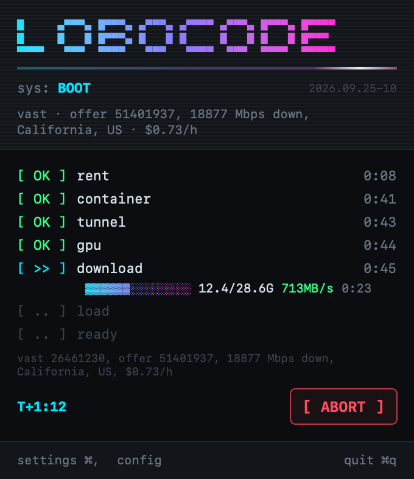
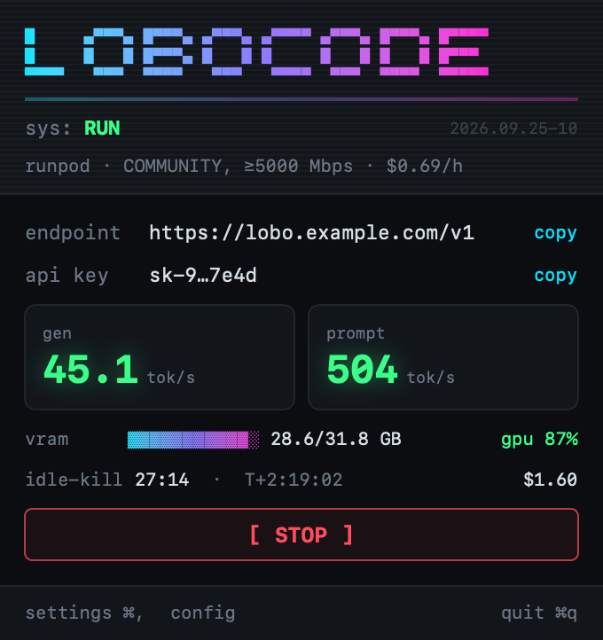
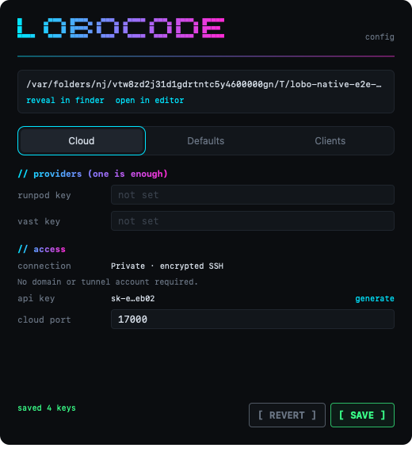
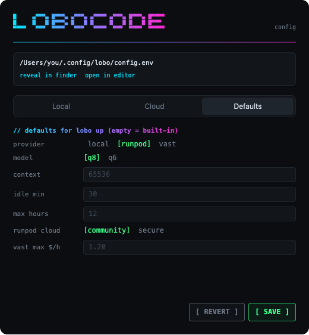
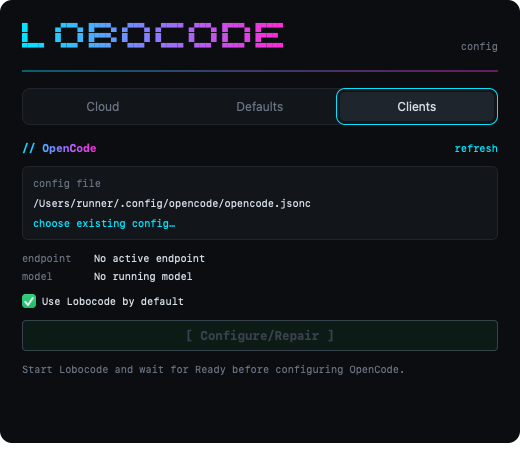
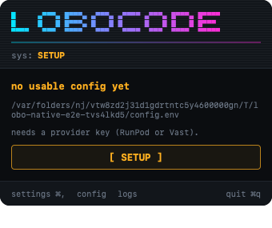

# lobocode

Run **Qwen3.8-27B abliterated** (huihui-ai, Q6_K) on a rented RunPod or Vast GPU from the standalone Mac app. Get an OpenAI-compatible API through a private SSH connection. Local inference is not supported.

**Mac app 0.2.4:** cloud-only, standalone, Apple Silicon. [Download the DMG](https://github.com/1905/lobocode/releases/download/app-v0.2.4/lobocode.dmg). Homebrew installs the legacy Go CLI, which cannot use `qwen38-q6`; the Rust CLI rewrite remains unreleased. Screenshots with performance numbers show sample data, not benchmark results.

The only supported model is `qwen38-q6` (huihui-ai Qwen3.8-27B abliterated, Q6_K). It runs only on a rented RunPod or Vast GPU. The app, the Rust CLI and its configuration form accept no other model and no local run. Each new start resolves the latest public `latest-qwen38-q6` image. The thin image downloads verified weights at boot. Broader telemetry acceptance remains pending.

<p align="center">
  
  
</p>

## TL;DR

- **What:** start a 5090 on RunPod or Vast.ai from the standalone Mac app or optional CLI. The app connects through private SSH at `http://127.0.0.1:8933/v1`. No domain or bucket is required.
- **Historical Qwen3.5 cloud check:** 47,000 uncached input tokens at 2,186.7 prompt tok/s; first content after 24.04 seconds. Sustained output speed remains unmeasured.
- **Historical Qwen3.5 startup:** the TUI reached Ready in 230.178 seconds. Mac Ready occurred between about 21m11s and 22m30s after the Start capture. The provider still reported downloading at 15 minutes. No transfer-byte progress or cache-hit evidence was captured.
- **Observed test rates:** $0.69/h and $0.99/h. Available prices vary. Default shutdown limits are 30 minutes idle and 12 hours maximum life.
- **Safe to forget:** the pod kills itself. Your account keys never leave your laptop.

For the Rust cloud candidate, build from source using the instructions below, then run:

```sh
bin/lobo-rs config       # configure provider and API keys
bin/lobo-rs up           # start qwen38-q6 on RunPod or Vast
bin/lobo-rs status       # inspect the running GPU
bin/lobo-rs down         # deletes all lobo instances on configured providers
```

The app's Stop button targets its recorded runtime. The CLI's `down` command retains its broader all-provider behavior.

## Install

The desktop app installs from its DMG and does not require the CLI. Install the optional CLI separately through Homebrew. [Download Mac app 0.2.4](https://github.com/1905/lobocode/releases/download/app-v0.2.4/lobocode.dmg), open the DMG, and drag **lobocode** to **Applications**. Requires Apple Silicon and macOS 13 or later. The app is ad-hoc signed and is not notarized.

**Published CLI through Homebrew** (macOS, Linux):

```sh
brew install 1905/tap/lobo
```

**Rust development build** (Rust from `rust-toolchain.toml`; Node.js and pnpm for the app):

```sh
git clone https://github.com/1905/lobocode && cd lobocode
make rust-build-lobo # → bin/lobo-rs; does not replace the installed CLI
make install-mac    # optional: the menu bar app → /Applications/lobocode.app
```

The source retains the legacy Go CLI and `make install` target until the Rust release. Use `bin/lobo-rs` to test the Rust CLI.

Open **Settings → Cloud**, enter a RunPod or Vast API key, save, and start `qwen38-q6`. An unavailable image fails before rental. Updating the app does not install or replace the optional CLI.

## What you need

**Mac app:** Apple Silicon and macOS 13 or later. Model weights and inference run on the cloud GPU. The app has no local model mode.

**In the cloud:**
- A **RunPod** or **Vast.ai** API key. One is enough.
- **OpenSSH** on the client computer. macOS includes it; Linux needs the `openssh-client` package.

`lobo config` asks for what your choice needs and writes `~/.config/lobo/config.env`.

New Rust configurations use a private SSH connection. Lobocode creates its own keys, checks the server identity, and forwards requests automatically. No domain, Cloudflare tunnel account, or connection subscription is required. GPU and provider bandwidth charges still apply.

The connection survives closing the app or finishing `lobo up`. It reconnects after a network interruption. The endpoint works only on that computer. Stop deletes the instance and closes the connection.

Existing complete domain/token configurations keep their public connection. Select **use private connection** in Cloud Settings, or set `LOBO_CONNECTION=ssh`, before the next start. The SSH mode needs the matching cloud agent, which the public image includes. The Rust CLI remains unreleased.

The GPU pulls a public Docker image with the agent, inference runtime and SSH server. The agent downloads verified model chunks at startup. No private bucket or developer credential is required.

Every new cloud start looks up the current `latest-qwen38-q6` tag and sends its exact digest to the provider. The app version does not select the image version. If the registry lookup fails, startup fails before renting; it does not reuse an older image.

## Use

| Command | What it does |
|---|---|
| `lobo up` | Rent a 5090, show boot progress, print the endpoint when ready. |
| `lobo status` | Live dashboard: cost, GPU, tok/s, idle-kill timer. |
| `lobo test` | Streamed chat + tool call against the live API. |
| `lobo logs` | Last agent, llama-server and tunnel log lines. |
| `lobo down` | Delete every `lobo` pod on every configured provider. Nothing else. |

Useful flags for `lobo up`: `--provider vast`, `--ctx 16384`, `--idle-min 10`, `--max-life 4h`.

Vast retired its v0 instance list (`GET /api/v0/instances/` returns HTTP 410). The Mac app and the Rust CLI (`bin/lobo-rs`) list through `/api/v1/instances/`. The published Homebrew CLI still uses the v0 list, so its Vast `up`, `status` and `down` commands fail until a new CLI release. RunPod is not affected.

The terminal dashboard updates in place. Press `q` to leave status; press `q` or Ctrl-C during startup to cancel and wait for cleanup. Short terminals use a compact layout that retains metrics, shutdown timers and the quit hint. The real RunPod check confirmed Ready and status fit 80 columns. Some startup detail lines still clip at that width.

## Local inference

Local inference code and commands are removed from the Rust app and CLI. Explicit local starts are rejected. Saved local preferences migrate to a configured cloud provider. Existing model files and local processes are left untouched. The released Homebrew CLI is the older Go build; its local mode and `q6`/`q8` models are unsupported.

## Menu bar app (macOS)


Start, watch the boot, copy the endpoint and key, see tok/s and spend, stop. The app uses the same Rust core and config file as the CLI. It manages only cloud GPUs; it does not download or load local model weights. Opening the app shows a native window, so it works when a full menu bar hides the item behind the notch.

Windows use native macOS title bars and rounded corners. Each view fits without scrolling. Settings groups controls into Cloud, Defaults and Clients tabs. The actual hosted app passed cloud Start, Ready, a direct reply, Stop and Off without scrolling; rounded corners were visible. Drag, Dock and Command-Tab behavior remain unverified.

The Mac cloud request used 25 uncached input tokens and returned the expected `4` in two output tokens. First content took 1.107 seconds. Ready displayed 22.8 / 31.8 GB of GPU memory. The idle gauges showed `0 / 0` after the reply; live rate updates were not verified. Owned pod/tunnel cleanup, native Quit and preference restoration passed. Loading-memory progression remains unfinished. Live OpenCode integration remains unverified. These measurements used the historical Qwen3.5 model, not the current model.

The [standalone DMG](https://github.com/1905/lobocode/releases/download/app-v0.2.4/lobocode.dmg) contains only the app. For development, `make install-mac` builds the app and `make dmg` creates `bin/lobocode.dmg`.

- The app is not notarized. If macOS blocks the first open, go to System Settings → Privacy & Security → **Open Anyway**. Or run `xattr -dr com.apple.quarantine /Applications/lobocode.app`.

<details><summary>Settings: Cloud, Defaults and Clients</summary>
<p></p>
<p></p>
<p></p>
</details>

## Startup diagnostics

<p></p>

Use **logs** in the app footer to reveal the persistent diagnostic file. The default path is `~/.config/lobo/config.app-logs/app.jsonl`. A custom app config has its own adjacent log directory. Logs include the app version, session, timestamps, selected provider/model, instance identity, startup checks, failures and cleanup outcomes. Credentials and request content are excluded. Each log is limited to 2 MiB; the app retains three older files.

During startup, the app shows the age of the last backend update. A missing update does not establish that the container is running. The app checks the selected provider instance before the agent connects and reports confirmed deletion. Provider errors remain unknown status. Startup timeout requests cancellation; unconfirmed cleanup blocks another Start and exposes Retry Stop. A logging failure is shown in the app.

## OpenCode

In the Mac app, wait for **Ready**, then select **OpenCode…** or open **Settings → Clients**. Confirm the displayed config file. Use **choose existing config…** for a different JSON or JSONC file. The app does not require the CLI or an OpenCode subprocess.

Leave **Use Lobocode by default** checked to set the default model and agent. Clear it to preserve existing defaults. Select **Configure/Repair**, then restart OpenCode. Project settings can override the selected file.

Setup authenticates the active endpoint and uses the running model and context limit. It preserves comments, unrelated providers and custom agent settings. Changed files receive a private backup; the API key stays in a private referenced file. An unchanged repair creates no extra files. Authentication or validation failure prevents replacement.

The app configures the `lobo` provider for its active cloud runtime. Existing provider restrictions remain in place and appear as warnings. A new `lobo` agent enables core coding tools and disables MCP tool and skill access. Existing custom agent controls remain unchanged.

The optional CLI retains its separate export command: `lobo gen-api-key` writes `opencode.lobo.json` for manual merging. It is not required for app setup. The settings screenshots show native test fixtures.

## Pod image

The GPU image contains the agent, inference runtime and SSH server. The only build target is `thin`, which is also the default. Model weights download at startup. Retired Q6/Q8 image packaging and shard loaders are removed.

The model list comes from `crates/lobo-proto/catalog.json`. The catalog contains only `qwen38-q6` (huihui-ai Qwen3.8-27B abliterated, Q6_K). The registry is `ghcr.io/1905/lobocode`; the supported model uses `latest-qwen38-q6`. A different registry must carry `latest-qwen38-q6`; otherwise the start fails with `cannot resolve latest <id> GPU image` before any rental.

The app resolves the selected tag again before each new start. The provider receives `ghcr.io/<LOBO_IMAGE_REPO>@sha256:<digest>`, by default `ghcr.io/1905/lobocode@sha256:<digest>`. It may reuse identical layers, but cannot substitute an older image digest.

`qwen38-q6` runs from a thin image (Dockerfile target `thin`) without weights and downloads its 22,430,999,840-byte GGUF as 84 content-addressed 256 MiB chunks from `{LOBO_MODEL_BASE_URL}/models/{sha256}/{nnn}`, by default `https://models.stealthcopilot.io`. A project contributor operates that CDN. If the CDN fails or is too slow, the agent downloads the same byte ranges from the original file on Hugging Face (`https://huggingface.co/<repo>/resolve/main/<file>`). The agent verifies the SHA-256 of every chunk from either source against the table pinned in the catalog. That table was checked against the complete Hugging Face file on October 26, 2026. It starts 4 parallel streams, adds 4 per 5 s window while aggregate throughput rises by at least 10 %, and stops at the cap from the control plane (default 32). A stream that is far slower than the rest restarts once per chunk. The hidden `--conns` option overrides the cap; values below 2 are rejected. The slow-host check (`LOBO_MIN_MBPS`) uses the rate over the last 5 s before the 20 s check. No user needs a token to download.

Chunk publication uses the hidden command `lobo publish-model <ID> --file <PATH>` on the authorized Linux build host with the owner's R2 credentials. Pin the resulting hashes in `crates/lobo-proto/catalog.json`. Before publishing a thin image, check that all chunks are available and verify the first and last chunk hashes. Build Dockerfile target `thin`, smoke-test its agent and SSH runtime, then promote its verified digest to `latest-<id>`. Never promote a thin image to the legacy `latest-q6` or `latest-q8` tags. The `qwen38-q6` chunks were published by the contributor; this repository holds no R2 secrets for them.

For CLI development only, an explicit image override is available:

```sh
lobo up --image ghcr.io/1905/lobocode@sha256:<digest>
```

Normal starts ignore old `LOBO_POD_IMAGE`, bucket and model-source settings. The obsolete `--release`, `--source` and debug `--ssh` options return an error before rental.

The image pull transfers the runtime, then the agent downloads 22.4 GB of model chunks. The default startup limit is 40 minutes. A host that cannot start the container within 30 minutes is removed; this covers the image pull. The chunk download runs after the container starts and falls under the 40-minute limit. Cancellation also removes the owned instance.

A new GPU host may need to download every image layer and model chunk. Cached layers or chunks are not guaranteed.

## Config reference

The table describes the Rust app and CLI configuration. Starts use only RunPod or Vast and only `qwen38-q6`. The Homebrew CLI is the older Go build and accepts only `q6` and `q8` for `LOBO_MODEL`; a config saved with `qwen38-q6` does not work with that CLI.

`~/.config/lobo/config.env`, plain `KEY=value`, mode 600. Only this file is read. The shell environment is never used. A flag beats the file, and the file beats the built-in default.

| Key | Flag | Default |
|---|---|---|
| `LOBO_PROVIDER` (runpod, vast) | `--provider` | runpod |
| `LOBO_CONNECTION` (ssh, cloudflare) | | ssh for new configurations |
| `LOBO_CLOUD_PORT` (control API on port + 1) | | 8933 |
| `LOBO_MODEL` (qwen38-q6 only; saved q6/q8 values migrate on load and save) | | qwen38-q6 |
| `LOBO_MODEL_BASE_URL` (base URL of the model chunks; https only, trailing slash ignored; shown unmasked by `lobo config show`) | | `https://models.stealthcopilot.io` |
| `LOBO_IMAGE_REPO` (GHCR repository with the `latest-qwen38-q6` image) | | 1905/lobocode |
| `LOBO_CTX` | `--ctx` | 65536 |
| `LOBO_IDLE_MIN` | `--idle-min` | 30 |
| `LOBO_MAX_HOURS` | `--max-life` | 12 |
| `LOBO_CLOUD` (community, secure) | `--cloud` | community |
| `LOBO_MIN_MBPS` (minimum advertised Vast host speed, MB/s; also the agent's measured-rate gate during the chunk download: rate over the last ~5 s before the 20 s check, a slower host is replaced) | `--min-mbps` | 100 |
| `LOBO_VAST_MAX_DPH` | | 1.20 |

SSH mode selects RunPod hosts with public TCP mappings and Vast hosts with direct ports. This can reduce host availability. `LOBO_DOMAIN` and `CF_TUNNEL_TOKEN` are only needed for the legacy `cloudflare` connection.

## Safety

- **Idle kill:** 30 min without requests. **Hard expiry:** fixed at create time, 12 h by default.
- The pod deletes itself with a pod-scoped key that the provider injects. Your account keys stay on the laptop.
- Bad hosts can be replaced automatically: container never started, broken CUDA or unavailable VRAM. At most 4 tries, within the startup limit.

## Development

| Area | Source | Checks |
|---|---|---|
| Shared protocol | `crates/lobo-proto` | `make proto-ts` |
| Pod agent and shared core | `crates/lobo-agent`, `crates/lobo-core` | `make rust-test rust-lint` on Feesh |
| Rust CLI and TUI | `crates/lobo-cli` | `cargo test -p lobo-cli --test tui_parity` |
| Native app | `app/src-tauri`, `app/ui` | `make app-lint`, `pnpm -C app/ui test` |
| Native UI smoke | `app/e2e` | `make app-e2e` (cloud setup, legacy migration and removed IPC) |

The app calls the shared Rust core directly and does not bundle the CLI. Go source and frozen compatibility fixtures remain until cutover.

Use the development Mac for source edits and orchestration. Run Linux builds and backend/lifecycle checks on Feesh. Build and test the macOS app on Air. GitHub Actions is disabled; this repository has no build or release workflows. Live GPU checks require authorization. `make release` publishes an agent; it is not a local build command.

Image builds no longer download or package retired model weights. Build the image on the Linux AMD64 build host and verify its runtime before publication.

App releases use an `app-vX.Y.Z` tag at the exact tested `master` commit. Run workspace tests on Feesh and app tests plus native fresh/legacy setup smoke on Air. Check anonymous access to `latest-qwen38-q6` before publishing the DMG, checksums and source receipt. Build the standalone DMG on Air with `make dmg`; do not bundle or replace the optional CLI.

CLI releases require separate authorization. Image publication is separate from normal app startup. End users always resolve the current public image at each new start.

Maintainers must make the `1905/lobocode` container package public before release acceptance. New GHCR packages default to private. The anonymous-access check deliberately fails until visibility is public. End users do not need a GitHub account or registry credentials. See [GitHub's container registry documentation](https://docs.github.com/en/packages/working-with-a-github-packages-registry/working-with-the-container-registry).
